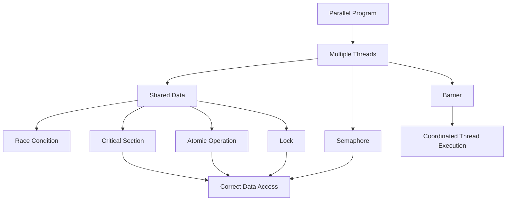
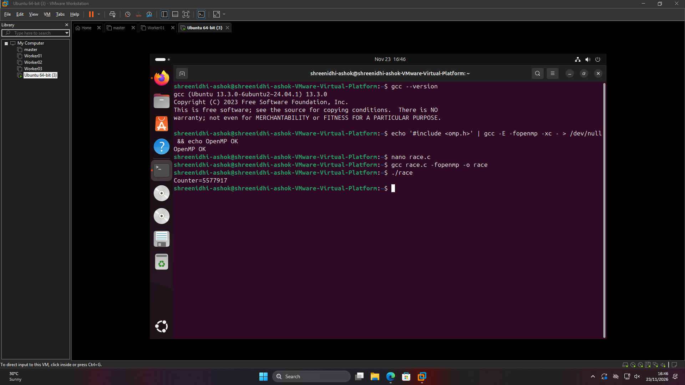
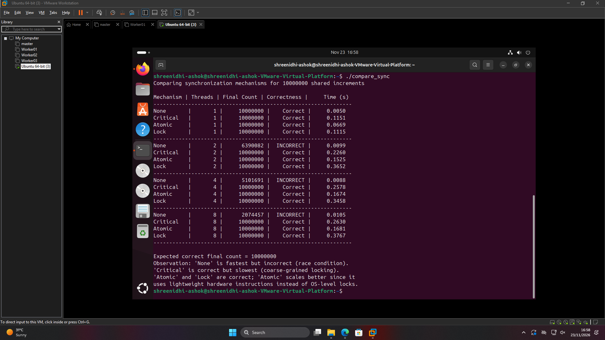

# EXPERIMENT 03: ANALYSIS OF SYNCHRONIZATION MECHANISMS IN PARALLEL PROGRAMS

## 1. Objective

To implement and study common synchronization mechanisms used in shared-memory parallel programs, including:

- Race conditions
- Critical sections
- Atomic operations
- Barriers
- Semaphores
- Locks

To evaluate the correctness, execution time, and scalability of these mechanisms by increasing the number of threads.

---

## 2. Software and Hardware Requirements

### 2.1 Software Requirements

| S.No. | Software / Tool | Purpose |
|---|---|---|
| 1 | VMware Workstation Pro | Virtualization software to host Ubuntu |
| 2 | Ubuntu 22.04 LTS | Operating system |
| 3 | GCC Compiler | Compiles C programs |
| 4 | OpenMP (libgomp) | Parallel programming and synchronization |
| 5 | POSIX Threads (Pthreads) | Creates and manages threads |
| 6 | POSIX Semaphore Library | Provides semaphore-based synchronization |
| 7 | Ubuntu Terminal | Compiling and executing programs |

### 2.2 Hardware Requirements

- Multi-core processor
- Minimum 4 CPU cores recommended
- Minimum 2 GB RAM
- At least 20 GB disk space

---

## 3. Theory

### 3.1 Why Synchronization is Needed

In a shared-memory parallel program, multiple threads can access the same variable at the same time.

When two or more threads modify shared data without proper coordination, the final result may become incorrect.

Synchronization mechanisms control access to shared resources and help ensure correct program execution.

### 3.2 Race Condition

A race condition occurs when multiple threads access and modify shared data without synchronization.

For example, `counter++` involves reading the old value, increasing it, and writing the updated value.

If multiple threads perform these operations simultaneously, some updates may be lost.

This results in an incorrect and unpredictable counter value.

### 3.3 Critical Section

A critical section is a part of the program that allows only one thread to execute at a time.

OpenMP provides the `#pragma omp critical` directive to implement critical sections.

Other threads must wait until the current thread finishes executing the protected section.

It ensures correctness but may reduce performance when many threads compete for the same resource.

### 3.4 Atomic Operation

An atomic operation ensures that a simple shared-variable update is performed without interference from other threads.

OpenMP provides the `#pragma omp atomic` directive.

It is suitable for simple operations such as incrementing a shared counter.

Atomic operations generally have lower overhead than general critical sections for simple updates, although actual performance depends on the processor and workload.

### 3.5 Barrier

A barrier is a synchronization point where all threads must arrive before any thread can continue beyond that point.

OpenMP provides the `#pragma omp barrier` directive.

It is useful when a parallel program has multiple phases and all threads must finish one phase before starting the next.

### 3.6 Semaphore

A semaphore is a synchronization mechanism that uses a counter to control access to shared resources.

The POSIX semaphore functions are:

- `sem_init()` – Initializes the semaphore.
- `sem_wait()` – Decreases the semaphore value and waits when access is unavailable.
- `sem_post()` – Increases the semaphore value.
- `sem_destroy()` – Destroys the semaphore.

A binary semaphore initialized with value 1 allows one thread at a time into the protected section.

### 3.7 Lock

A lock is used to protect shared data from simultaneous access.

OpenMP provides the following functions:

- `omp_init_lock()` – Initializes a lock.
- `omp_set_lock()` – Acquires the lock.
- `omp_unset_lock()` – Releases the lock.
- `omp_destroy_lock()` – Destroys the lock.

A thread must acquire the lock before accessing the protected resource.

### 3.8 Correctness, Performance and Scalability

The synchronization mechanisms are evaluated using three properties:

**Correctness:** Whether the program produces the expected result.

**Performance:** The time required to execute the program.

**Scalability:** How performance changes when the number of threads increases.

A synchronization mechanism should provide correct results while keeping execution overhead as low as possible.

---

## 4. Synchronization Mechanisms – Working Diagram

The following diagram represents multiple threads accessing shared data using different synchronization mechanisms.



---

## 5. Installation and Setup

### 5.1 Install VMware Workstation Pro

1. Download VMware Workstation Pro from the official Broadcom website.
2. Run the installer.
3. Accept the license agreement.
4. Select the installation location.
5. Complete the installation.
6. Open VMware Workstation.

### 5.2 Create a Virtual Machine

1. Select **Create a New Virtual Machine**.
2. Choose Typical configuration.
3. Select the Ubuntu 22.04 LTS ISO file.
4. Enter a virtual machine name.
5. Allocate at least 20 GB disk space.
6. Allocate at least 4 CPU cores if available.
7. Allocate 2–4 GB RAM.
8. Finish creating the virtual machine.

### 5.3 Install Ubuntu 22.04 LTS

1. Start the virtual machine.
2. Select Install Ubuntu.
3. Choose the language and keyboard layout.
4. Follow the installation instructions.
5. Create a username and password.
6. Complete installation and restart the virtual machine.

### 5.4 Install GCC and OpenMP

Open the Ubuntu Terminal and execute:

**Update package information:**

```bash
sudo apt update
```

**Install GCC and required build tools:**

```bash
sudo apt install build-essential -y
```

**Verify GCC:**

```bash
gcc --version
```

**Verify OpenMP:**

```bash
echo '#include <omp.h>' | gcc -E -fopenmp -xc - > /dev/null && echo "OpenMP OK"
```

---

## 6. Programs and Source Code

All six C source files are available in the `code` directory.

### 6.1 Program 1 – Race Condition

**File:** `code/race.c`

**Description:**

This program increments a shared counter using multiple OpenMP threads without synchronization.

Because multiple threads update the same variable simultaneously, some increments may be lost.

**Concept:** Unsynchronized shared-variable access.

**Compilation:**

```bash
gcc code/race.c -fopenmp -o race
```

**Execution:**

```bash
OMP_NUM_THREADS=4 ./race
```

**Expected Observation:**

The counter may be less than 10,000,000 because of lost updates. The exact result is unpredictable. With one thread, the result should be 10,000,000.

### 6.2 Program 2 – Critical Section

**File:** `code/critical.c`

**Description:**

This program uses the OpenMP critical directive to protect the shared counter.

Only one thread can execute the protected increment at a time.

**Concept:** Mutual exclusion using a critical section.

**Compilation:**

```bash
gcc code/critical.c -fopenmp -o critical
```

**Execution:**

```bash
OMP_NUM_THREADS=4 ./critical
```

**Expected Output:**

```text
Counter = 10000000
```

### 6.3 Program 3 – Atomic Operation

**File:** `code/atomic.c`

**Description:**

This program uses the OpenMP atomic directive to perform an indivisible update of the shared counter.

It protects the increment operation without requiring a general critical section.

**Concept:** Atomic shared-variable update.

**Compilation:**

```bash
gcc code/atomic.c -fopenmp -o atomic
```

**Execution:**

```bash
OMP_NUM_THREADS=4 ./atomic
```

**Expected Output:**

```text
Counter = 10000000
```

### 6.4 Program 4 – Barrier

**File:** `code/barrier.c`

**Description:**

This program demonstrates how a barrier synchronizes multiple threads.

Each thread prints a message before reaching the barrier. All threads must reach the barrier before any thread can print its after-barrier message.

**Concept:** Synchronization between parallel execution phases.

**Compilation:**

```bash
gcc code/barrier.c -fopenmp -o barrier
```

**Execution:**

```bash
OMP_NUM_THREADS=4 ./barrier
```

**Expected Observation:**

All before-barrier messages appear before any after-barrier message. The order of messages within each group may vary.

### 6.5 Program 5 – Semaphore

**File:** `code/semaphore.c`

**Description:**

This program uses POSIX threads and a binary semaphore to protect a shared counter.

Two threads increment the counter 100,000 times each. The semaphore ensures that only one thread updates the counter at a time.

**Concept:** Mutual exclusion using a binary semaphore.

**Compilation:**

```bash
gcc code/semaphore.c -pthread -o semaphore
```

**Execution:**

```bash
./semaphore
```

**Expected Output:**

```text
Counter = 200000
```

### 6.6 Program 6 – Synchronization Comparison

**File:** `code/compare_sync.c`

**Description:**

This program compares four shared-counter update strategies:

1. None – No synchronization.
2. Critical – OpenMP critical section.
3. Atomic – OpenMP atomic operation.
4. Lock – OpenMP lock.

Each strategy performs 10,000,000 increments.

The program tests four thread configurations:

- 1 thread
- 2 threads
- 4 threads
- 8 threads

It measures execution time using `omp_get_wtime()` and checks the final counter against the expected value.

**Compilation:**

```bash
gcc code/compare_sync.c -fopenmp -o compare_sync
```

**Execution:**

```bash
./compare_sync
```

**Expected Observation:**

The program displays the final counter, correctness status, and execution time for each mechanism and thread configuration.

The unsynchronized version may produce incorrect results when multiple threads are used. The other three mechanisms protect the counter and should produce the expected final value.

---

## 7. Compilation and Execution Steps

Open the experiment directory:

```bash
cd Experiment-03-Synchronization
```

### Step 1: Compile the Race Condition Program

```bash
gcc code/race.c -fopenmp -o race
```

### Step 2: Compile the Critical Section Program

```bash
gcc code/critical.c -fopenmp -o critical
```

### Step 3: Compile the Atomic Operation Program

```bash
gcc code/atomic.c -fopenmp -o atomic
```

### Step 4: Compile the Barrier Program

```bash
gcc code/barrier.c -fopenmp -o barrier
```

### Step 5: Compile the Semaphore Program

```bash
gcc code/semaphore.c -pthread -o semaphore
```

### Step 6: Compile the Comparison Program

```bash
gcc code/compare_sync.c -fopenmp -o compare_sync
```

### Step 7: Execute the Programs

```bash
OMP_NUM_THREADS=4 ./race
OMP_NUM_THREADS=4 ./critical
OMP_NUM_THREADS=4 ./atomic
OMP_NUM_THREADS=4 ./barrier
./semaphore
./compare_sync
```

---

## 8. Execution and Output Screenshots

The following screenshots document the execution of the synchronization programs.

### 8.1 Race Condition



**Description:** Demonstrates the output of the program with unsynchronized access to the shared counter.

### 8.2 Critical Section


**Description:** Demonstrates protected counter updates using the OpenMP critical directive.

### 8.3 Atomic Operation


**Description:** Demonstrates the use of atomic operations for safe shared-variable updates.

### 8.4 Barrier Synchronization


**Description:** Shows the thread execution messages before and after the barrier.

### 8.5 Semaphore


**Description:** Demonstrates mutual exclusion using a binary semaphore.

### 8.6 Comparison Results



**Description:** Shows the comparison results for different synchronization mechanisms.

---

## 9. Performance and Correctness Analysis

The comparison program evaluates execution time and correctness for 1, 2, 4, and 8 threads.

### 9.1 Comparison Table

| Mechanism | Correctness | Performance Characteristics | Scalability |
|---|---|---|---|
| None | Not guaranteed | No synchronization overhead | Incorrect results are possible with multiple threads |
| Critical | Correct | Waiting and locking overhead | Can be limited by contention |
| Atomic | Correct | Lightweight protected updates | Often suitable for simple shared updates |
| Lock | Correct | Lock acquisition and release overhead | Can be limited by contention |

### 9.2 Execution Time Recording

Record the actual results produced by `compare_sync`.

| Mechanism | Threads | Final Count | Correctness | Execution Time (s) |
|---|---:|---:|---|---:|
| None | 1 | Record output | Record output | Record output |
| None | 2 | Record output | Record output | Record output |
| None | 4 | Record output | Record output | Record output |
| None | 8 | Record output | Record output | Record output |
| Critical | 1, 2, 4, 8 | Record output | Record output | Record output |
| Atomic | 1, 2, 4, 8 | Record output | Record output | Record output |
| Lock | 1, 2, 4, 8 | Record output | Record output | Record output |

**Note:** Execution time depends on processor specifications, available cores, virtual machine settings, and system load. The unsynchronized counter has a data race, so its result is not reliable. A single-thread run may still produce the correct count.

### 9.3 Important Observations

1. Unsynchronized access can result in lost updates.
2. Critical sections provide mutual exclusion but can cause waiting between threads.
3. Atomic operations protect simple shared-variable updates.
4. Barriers synchronize the progress of threads between computation phases.
5. Semaphores provide controlled access to shared resources.
6. Locks protect critical sections and prevent simultaneous updates.
7. Increasing the number of threads does not always improve performance because synchronization introduces overhead.

---

## 10. Result

The synchronization mechanisms were implemented using OpenMP, POSIX threads, and POSIX semaphores.

The programs demonstrate race conditions, mutual exclusion, atomic updates, thread barriers, and semaphore-based synchronization.

The comparison program evaluates correctness and execution time across different thread counts.

---

## 11. Conclusion

This experiment demonstrates the importance of synchronization in shared-memory parallel programming.

The race-condition program shows how unsynchronized access can produce incorrect results. Critical sections, atomic operations, locks, and semaphores provide mechanisms to protect shared resources. Barriers help coordinate the execution of parallel threads.

The comparison program helps study the trade-off between correctness, execution time, and scalability. Atomic operations are particularly useful for simple shared-variable updates, while critical sections, locks, and semaphores are useful when more controlled access is required.

---

## 12. References

1. GCC Documentation – https://gcc.gnu.org/onlinedocs/
2. OpenMP Documentation – https://www.openmp.org/specifications/
3. POSIX Threads Documentation – https://man7.org/linux/man-pages/man7/pthreads.7.html
4. Linux Semaphore Documentation – https://man7.org/linux/man-pages/man7/sem_overview.7.html