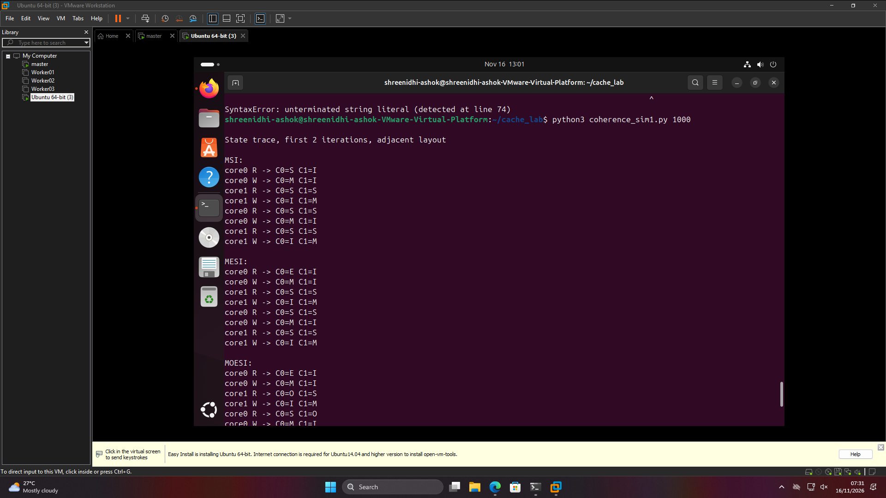
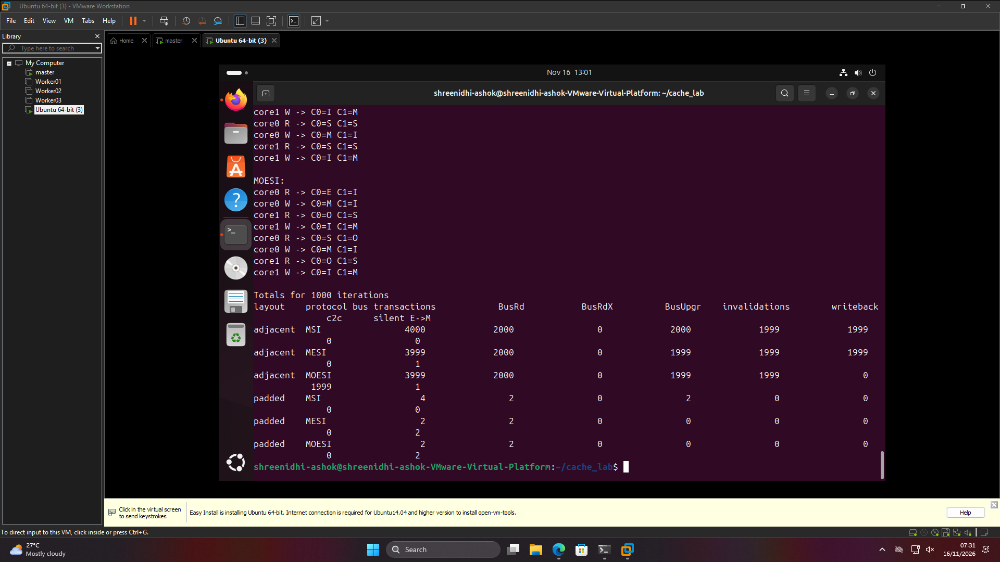
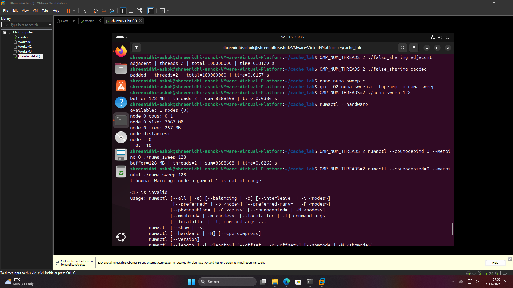
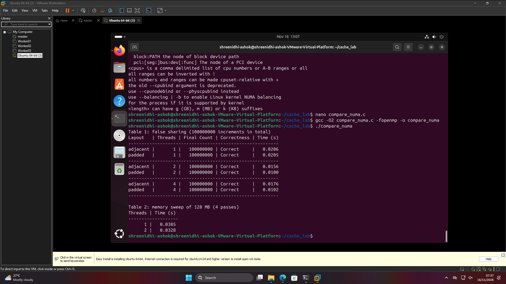

# Experiment 04 – Cache Coherence and NUMA

## 1. Aim

To study cache coherence protocols (MSI, MESI and MOESI), understand false sharing in multicore systems, and investigate the effect of NUMA memory placement on program performance.

## 2. Objectives

- Understand cache coherence in multicore processors.
- Study MSI, MESI and MOESI cache coherence protocols.
- Simulate cache states and coherence transactions.
- Understand false sharing and how padding reduces it.
- Compare adjacent and padded memory layouts.
- Study local and remote NUMA memory access.
- Observe the effect of memory placement on program performance.

## 3. Software and Hardware Requirements

### Software Requirements

- VMware Workstation Pro
- Ubuntu 22.04 LTS
- GCC compiler
- Python 3
- OpenMP
- numactl
- hwloc
- Ubuntu Terminal

### Hardware Requirements

- Multicore processor
- Minimum 4 GB RAM
- Minimum 4 virtual CPUs for the virtual machine

## 4. Theory

### 4.1 Cache Coherence

In a multicore processor, each CPU core may have its own private cache. When multiple cores access the same memory location, their cached copies must remain consistent.

Cache coherence protocols maintain consistency between these copies.

A cache coherence protocol controls how a cache line changes its state when a processor reads or writes data.

### 4.2 Cache Coherence Protocols

#### MSI Protocol

MSI has three states:

- Modified (M): The cache has modified data that is different from main memory.
- Shared (S): The cache contains a clean copy that may be shared.
- Invalid (I): The cache line is not valid.

#### MESI Protocol

MESI adds one more state to MSI:

- Exclusive (E): The cache has the only clean copy of the cache line.

A write from Exclusive to Modified can happen without an additional bus transaction.

#### MOESI Protocol

MOESI adds the Owned (O) state:

- Owned (O): A cache holds modified data that may be shared with other caches. The owner is responsible for providing the data and eventually writing it back.

This can avoid an immediate memory writeback when another core reads a modified cache line.

### 4.3 False Sharing

False sharing occurs when two or more processor cores modify different variables that are located in the same cache line.

Although the variables are independent, the cache coherence system works at cache-line level. This causes unnecessary cache-line transfers between cores.

**Adjacent layout:** Variables are stored close together in the same cache line.

**Padded layout:** Extra space is added between variables so that they occupy separate cache lines.

Padding can reduce false sharing and improve performance.

### 4.4 NUMA

NUMA stands for Non-Uniform Memory Access.

In a NUMA system, processors have different memory access times depending on where the memory is located.

- Local memory: Memory connected to the processor's own NUMA node.
- Remote memory: Memory connected to another NUMA node.

Local memory access is generally faster than remote memory access.

The `numactl` command can control CPU and memory placement during program execution.

### 4.5 First-Touch Policy

First-touch is a memory placement policy in which physical memory pages are generally allocated on the NUMA node of the processor that first accesses them.

It is important when studying NUMA performance.

## 5. Environment Setup

### Step 1: Configure the Virtual Machine

Create an Ubuntu 22.04 virtual machine using VMware Workstation.

Recommended configuration:

- Processors: 4 virtual CPUs
- Memory: 4 GB RAM
- Operating System: Ubuntu 22.04 LTS

### Step 2: Update Ubuntu

```bash
sudo apt update
```

### Step 3: Install Required Packages

```bash
sudo apt install build-essential numactl hwloc python3 -y
```

### Step 4: Verify GCC

```bash
gcc --version
```

### Step 5: Verify OpenMP

```bash
echo '#include <omp.h>' | gcc -E -fopenmp -xc - > /dev/null && echo OpenMP OK
```

### Step 6: Check CPU and NUMA Information

```bash
lscpu | grep -E "Socket|Core|Thread|NUMA"
```

```bash
numactl --hardware
```

```bash
lscpu -e
```

## 6. Programs

### Program 1: Cache Coherence Protocol Simulator

**File:** `code/coherence_sim.py`

**Description:**

This Python program simulates two processor cores and compares MSI, MESI and MOESI cache coherence protocols.

It reports:

- Bus transactions
- Memory writebacks
- Cache-to-cache transfers
- Silent upgrades

**Execution:**

```bash
python3 code/coherence_sim.py 1000
```

**Result:**

The simulator successfully compares the three cache coherence protocols.

### Program 2: False Sharing Experiment

**File:** `code/false_sharing.c`

**Description:**

This C program uses OpenMP to compare two memory layouts:

- Adjacent counters
- Padded counters

Each thread updates its own counter. The execution time is measured for both layouts.

**Compilation:**

```bash
gcc -O2 -std=c11 -fopenmp code/false_sharing.c -o code/false_sharing
```

**Execution:**

```bash
OMP_NUM_THREADS=2 ./code/false_sharing adjacent
```

```bash
OMP_NUM_THREADS=2 ./code/false_sharing padded
```

**Expected observation:**

Both layouts should produce the correct total count. Their execution times may differ because of cache-line sharing.

### Program 3: NUMA Memory Access Experiment

**File:** `code/numa_sweep.c`

**Description:**

This program allocates a memory buffer, initializes it, and reads memory locations at cache-line intervals using OpenMP.

It measures the execution time of memory access operations.

**Compilation:**

```bash
gcc -O2 -std=c11 -fopenmp code/numa_sweep.c -o code/numa_sweep
```

**Execution:**

Local memory placement:

```bash
numactl --cpunodebind=0 --membind=0 ./code/numa_sweep
```

Remote memory placement:

```bash
numactl --cpunodebind=0 --membind=1 ./code/numa_sweep
```

**Expected observation:**

Local and remote memory access times can be compared when the system provides separate NUMA memory nodes.

### Program 4: NUMA and False Sharing Comparison

**File:** `code/compare_numa.c`

**Description:**

This program compares adjacent and padded counters using different thread counts:

- 1 thread
- 2 threads
- 4 threads

It checks the total count and measures execution time.

It can also be executed with different NUMA memory placement settings.

**Compilation:**

```bash
gcc -O2 -std=c11 -fopenmp code/compare_numa.c -o code/compare_numa
```

**Execution:**

```bash
./code/compare_numa
```

Local NUMA execution:

```bash
numactl --cpunodebind=0 --membind=0 ./code/compare_numa
```

Remote NUMA execution:

```bash
numactl --cpunodebind=0 --membind=1 ./code/compare_numa
```

**Expected observation:**

The program compares execution time and correctness for different thread counts and memory layouts.

## 7. Screenshots

### 7.1 Environment Setup





### 7.2 False Sharing Experiment


### 7.3 NUMA Memory Access Experiment


### 7.4 NUMA Comparison





## 8. Results and Observations

1. Cache coherence protocols maintain consistent data between processor caches.
2. MSI uses three states: Modified, Shared and Invalid.
3. MESI introduces the Exclusive state and supports silent upgrades.
4. MOESI introduces the Owned state, which can avoid immediate memory writebacks.
5. False sharing can occur when different threads modify variables in the same cache line.
6. Padding separates frequently updated variables and can reduce false sharing.
7. NUMA performance depends on the location of memory relative to the processor.
8. Local memory access is generally faster than remote memory access on systems with genuine separate NUMA nodes.
9. Performance depends on the processor, number of threads, memory placement and system configuration.

**Note:** Actual execution times and performance comparisons should be taken from the experiment screenshots and measured outputs. Results may vary across systems. A virtual machine may not show a clear local-versus-remote NUMA performance difference.

## 9. Conclusion

In this experiment, cache coherence protocols MSI, MESI and MOESI were studied and simulated. False sharing was examined by comparing adjacent and padded memory layouts. NUMA memory access was also investigated using local and remote memory placement.

The experiment helped demonstrate how cache coherence, memory layout and NUMA placement affect multicore program performance.
