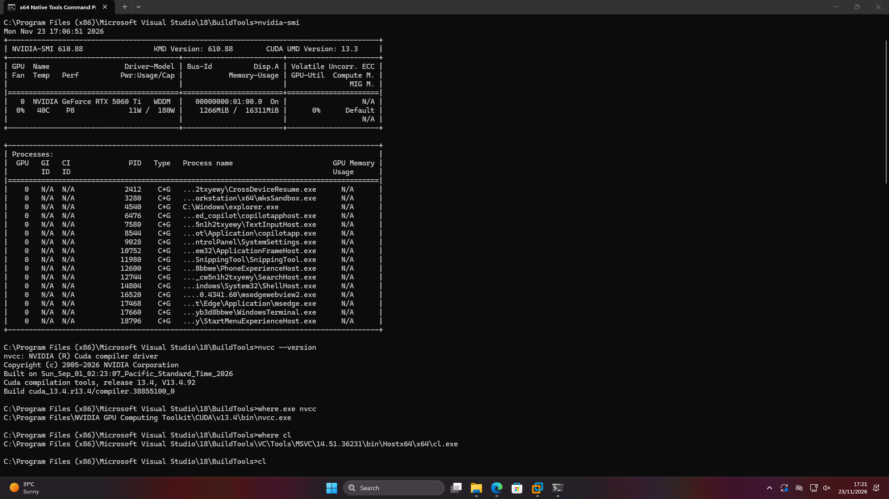
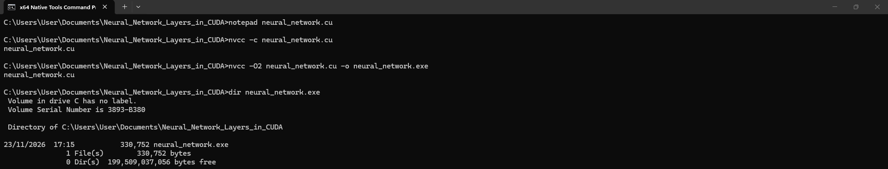
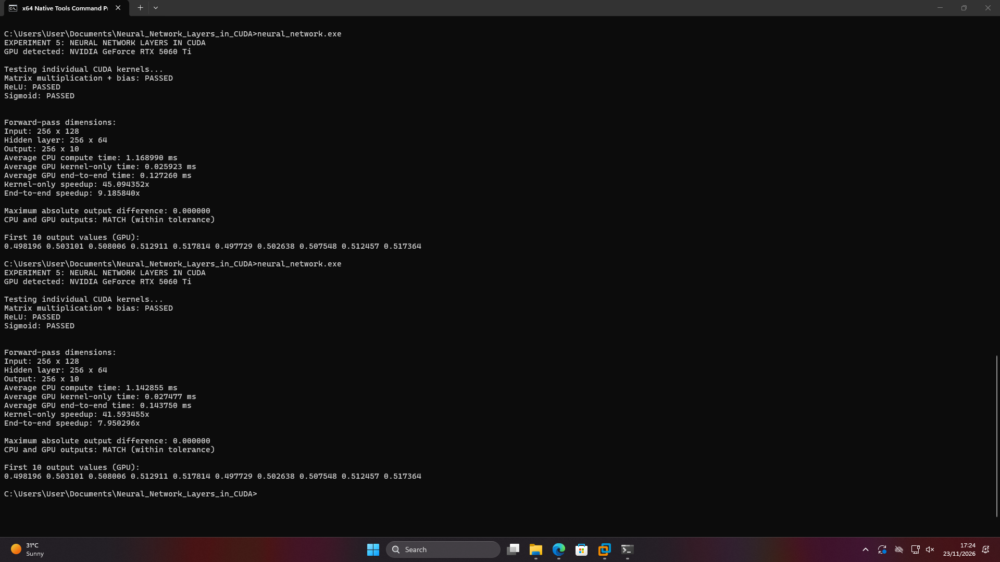

# Experiment 05 – Neural Network Layers in CUDA


## 1. Aim


To implement and evaluate basic neural-network layers using custom CUDA kernels, including matrix multiplication with bias, ReLU activation and Sigmoid activation. Execute the same forward pass on CPU and GPU, validate numerical correctness, measure execution time and calculate GPU speedup.


## 2. Learning Outcomes


After completing this experiment, students should be able to:


1\. Understand CUDA kernels, blocks, threads and grid dimensions.

2\. Implement matrix multiplication with bias using CUDA.

3\. Implement ReLU and Sigmoid activation kernels.

4\. Allocate and transfer data between host and device memory.

5\. Compare CPU and GPU computation results.

6\. Measure execution time and calculate GPU speedup.


## 3. Software and Hardware Requirements


### Hardware Requirements

\- NVIDIA CUDA-capable GPU

\- Windows 10/11 64-bit computer

\- Sufficient RAM


### Software Requirements

\- NVIDIA GPU driver

\- NVIDIA CUDA Toolkit

\- Visual Studio 2022 Build Tools

\- MSVC v143 x64/x86 build tools

\- Windows 10/11 SDK


### Demonstrated Environment


\- GPU: NVIDIA RTX 4500 Ada Generation

\- CUDA Toolkit: 13.0

\- Compiler: NVIDIA NVCC

\- Programming Language: CUDA C++


Note: Other systems may show different execution times depending on their hardware and configuration.


## 4. Theory


A neural network forward pass calculates outputs by applying weighted sums and activation functions.


This experiment implements a two-layer feed-forward neural network.


\*\*Layer 1:\*\*


Z1 = X × W1 + b1


A1 = ReLU(Z1)


\*\*Layer 2:\*\*


Z2 = A1 × W2 + b2


Y = Sigmoid(Z2)


This experiment performs only forward propagation. It does not include training, loss calculation, optimization or backpropagation.


### 4.1 Matrix Multiplication with Bias


Matrix multiplication combines two matrices to produce an output matrix.


For matrix A of size M × K and matrix B of size K × N, the output C has dimensions M × N.


C[row, col] = Sum of A[row, k] × B[k, col] + bias[col]


Each CUDA thread calculates one output element. The row and column are calculated using blockIdx, blockDim and threadIdx.


Boundary checks ensure that threads outside the matrix dimensions do not access invalid memory.


### 4.2 ReLU Activation


ReLU stands for Rectified Linear Unit.


Formula:


ReLU(x) = max(0, x)


\- Negative values become zero.

\- Positive values remain unchanged.


Each CUDA thread processes one array element.


### 4.3 Sigmoid Activation


Sigmoid is an activation function that converts values into a range between 0 and 1.


Formula:


Sigmoid(x) = 1 / (1 + exp(-x))


Each CUDA thread processes one element.


### 4.4 CPU and GPU Execution


\*\*CPU Execution:\*\*

\- Uses normal C++ functions and loops.

\- Performs matrix multiplication and activation operations sequentially.


\*\*GPU Execution:\*\*

\- Copies inputs and weights to device memory.

\- Launches CUDA kernels.

\- Executes matrix multiplication and activation functions.

\- Copies the final output back to host memory.


## 5. Network Configuration


The experiment uses the following network configuration.


| Parameter | Value |

|---|---:|

| Batch Size | 256 |

| Input Size | 128 |

| Hidden Size | 64 |

| Output Size | 10 |

| Repeats | 20 |


### Tensor Shapes


| Tensor | Shape |

|---|---|

| Input X | 256 × 128 |

| Weight W1 | 128 × 64 |

| Bias b1 | 64 elements |

| Hidden Activation | 256 × 64 |

| Weight W2 | 64 × 10 |

| Bias b2 | 10 elements |

| Final Output | 256 × 10 |


Inputs and weights are generated using deterministic sine and cosine functions. This ensures that the CPU and GPU receive identical data.


## 6. Environment Setup


The experiment was performed using a Windows system with NVIDIA CUDA support.


### Step 1: Check NVIDIA GPU and Driver


Open the command prompt and execute:


```bash

nvidia-smi

```


This command displays the NVIDIA GPU name, driver version and CUDA compatibility information.


### Step 2: Check CUDA Compiler


Execute:


```bash

nvcc --version

```


This command displays the installed CUDA compiler version.


### Step 3: Locate CUDA Compiler


Execute:


```bash

where.exe nvcc

```


This displays the location of the NVIDIA CUDA compiler.


### Step 4: Check Microsoft C++ Compiler


Open Developer Command Prompt for Visual Studio 2022.


Execute:


```bash

where cl

```


This checks whether the Microsoft C++ compiler is available.


### Step 5: Verify Compiler


Execute:


```bash

cl

```


The compiler version and usage information confirm that the C++ compiler is available.


## 7. Program Implementation


The complete source code is available in:


`code/neural_network.cu`


The program is divided into the following parts:


### 7.1 CUDA Libraries and Constants


The program includes CUDA runtime, C++ standard libraries and error-handling functions.


The network dimensions are defined using constants:


\- BATCH = 256

\- INPUT_SIZE = 128

\- HIDDEN_SIZE = 64

\- OUTPUT_SIZE = 10

\- REPEATS = 20


### 7.2 Matrix Multiplication Kernel


The matrix multiplication kernel calculates the weighted sum of input values and adds the corresponding bias.


Each CUDA thread calculates one output matrix element.


### 7.3 ReLU Kernel


The ReLU kernel applies the ReLU activation function to every element.


Negative values are converted to zero.


### 7.4 Sigmoid Kernel


The Sigmoid kernel applies the sigmoid activation function to every element.


The output values are between zero and one.


### 7.5 CPU Forward Pass


The CPU implementation performs the same operations using normal C++ functions.


It is used as the reference implementation for comparing GPU results.


### 7.6 GPU Forward Pass


The GPU forward pass launches four kernels in the following order:


1\. Matrix multiplication with bias.

2\. ReLU activation.

3\. Matrix multiplication with bias.

4\. Sigmoid activation.


### 7.7 Kernel Validation


Three individual kernel tests are performed:


\- Matrix multiplication with bias.

\- ReLU activation.

\- Sigmoid activation.


Each test uses small input values with known expected results.


### 7.8 CPU and GPU Comparison


The program compares CPU and GPU output values and calculates the maximum absolute difference.


The outputs are considered matching when the difference is below 0.0001.


## 8. Compilation and Execution


The following commands are executed using the Developer Command Prompt for Visual Studio 2022.


### Step 1: Create Project Folder


```cmd

mkdir "%USERPROFILE%\\Documents\\Experiment5_CUDA"

```


### Step 2: Move into the Project Folder


```cmd

cd /d "%USERPROFILE%\\Documents\\Experiment5_CUDA"

```


### Step 3: Compile the CUDA Program


After saving `neural_network.cu` in the project folder, execute:


```cmd

nvcc -O2 neural_network.cu -o neural_network.exe

```


### Step 4: Run the Program


```cmd

neural_network.exe

```


### Step 5: Repeat Execution


Run the program two more times to observe variations in execution time.


Note: The source file is maintained in this repository under `code/neural_network.cu`. The commands above describe the experiment execution procedure.


## 9. Expected Output


The following output is the reference result from the demonstrated NVIDIA RTX 4500 Ada Generation workstation.


```text

EXPERIMENT 5: NEURAL NETWORK LAYERS IN CUDA


GPU detected: NVIDIA RTX 4500 Ada Generation


Testing individual CUDA kernels...


Matrix multiplication + bias: PASSED

ReLU: PASSED

Sigmoid: PASSED


Forward-pass dimensions:

Input: 256 x 128

Hidden layer: 256 x 64

Output: 256 x 10


Average CPU compute time: 0.526860 ms

Average GPU kernel-only time: 0.026517 ms

Average GPU end-to-end time: 0.066010 ms


Kernel-only speedup: 19.868913x

End-to-end speedup: 7.981518x


Maximum absolute output difference: 0.000000


CPU and GPU outputs: MATCH (within tolerance)


First 10 output values (GPU):

0.498196 0.503101 0.508006 0.512911 0.517814

0.497729 0.502638 0.507548 0.512457 0.517364

```


Note: The execution times shown above are reference values from the demonstrated workstation. They should not be treated as measurements from another computer.


## 10. Timing Methodology


The experiment measures CPU and GPU execution time.


### CPU Timing


\- Executes the forward pass 20 times.

\- Calculates the average execution time.


### GPU Warm-up


The GPU performs one initial forward pass before timing to reduce first-launch initialization overhead.


### GPU Kernel-only Timing


\- Uses CUDA events.

\- Input data and weights are already stored in GPU memory.

\- Measures repeated CUDA kernel execution.


### GPU End-to-end Timing


Includes:


\- Host-to-device data transfers.

\- GPU kernel execution.

\- Device synchronization.

\- Device-to-host output transfer.


The two GPU measurements cover different execution scopes.


## 11. Formulae and Result Interpretation


### Kernel-only Speedup


Kernel-only Speedup = CPU Average Time / GPU Kernel-only Time


### End-to-end Speedup


End-to-end Speedup = CPU Average Time / GPU End-to-end Time


### Maximum Absolute Difference


Maximum Difference = max |CPU Output - GPU Output|


A speedup greater than 1 indicates that the GPU execution is faster for the measured scope.


End-to-end speedup is generally lower than kernel-only speedup because it includes data-transfer overhead.


## 12. Code Overview


| Program Component | Purpose |

|---|---|

| CUDA_CHECK | Handles CUDA errors |

| matrixMulBiasKernel | Performs matrix multiplication with bias |

| reluKernel | Applies ReLU activation |

| sigmoidKernel | Applies Sigmoid activation |

| cpuMatMulBias | Performs CPU matrix multiplication |

| cpuReLU | Performs CPU ReLU activation |

| cpuSigmoid | Performs CPU Sigmoid activation |

| cpuForwardPass | Executes the CPU forward pass |

| launchGpuForwardPass | Launches GPU kernels |

| testMatrixKernel | Validates matrix multiplication |

| testReLUKernel | Validates ReLU |

| testSigmoidKernel | Validates Sigmoid |

| main | Executes the complete experiment |


## 13. Observation Table


The following table contains reference values from the demonstrated workstation. Actual observations should be recorded from the experiment's execution output.


| Measurement | Reference Result | Unit |

|---|---:|---|

| CPU Average Compute Time | 0.526860 | ms |

| GPU Kernel-only Time | 0.026517 | ms |

| GPU End-to-end Time | 0.066010 | ms |

| Kernel-only Speedup | 19.868913 | × |

| End-to-end Speedup | 7.981518 | × |

| Maximum Absolute Difference | 0.000000 | - |


### Validation Results


| Test | Expected Result |

|---|---|

| Matrix Multiplication + Bias | PASSED |

| ReLU | PASSED |

| Sigmoid | PASSED |

| CPU and GPU Output | MATCH |

| Output Difference | Below 0.0001 |


## 14. Screenshots


### 14.1 CUDA Environment Setup





### 14.2 Compilation Success





### 14.3 Final Execution Output





## 15. Precautions


1\. Use an NVIDIA CUDA-capable GPU.

2\. Install a compatible NVIDIA driver and CUDA Toolkit.

3\. Use Developer Command Prompt for Visual Studio 2022.

4\. Save the source file with the `.cu` extension.

5\. Use a writable project directory.

6\. Check CUDA errors before interpreting results.

7\. Verify CPU and GPU output correctness.

8\. Record actual execution times instead of copying reference timings.

9\. Run the program multiple times to observe timing variations.


## 16. Conclusion


In this experiment, custom CUDA kernels for matrix multiplication with bias, ReLU activation and Sigmoid activation were implemented and tested.


The kernels were combined to perform a two-layer neural-network forward pass. CPU and GPU outputs were compared to verify numerical correctness.


Execution times were measured to calculate kernel-only and end-to-end GPU speedups.


In the demonstrated reference execution, all kernel tests passed and the CPU and GPU outputs matched within the specified tolerance.


Thus, the experiment demonstrated the use of CUDA programming for implementing and evaluating basic neural-network layers using GPU parallel processing.


